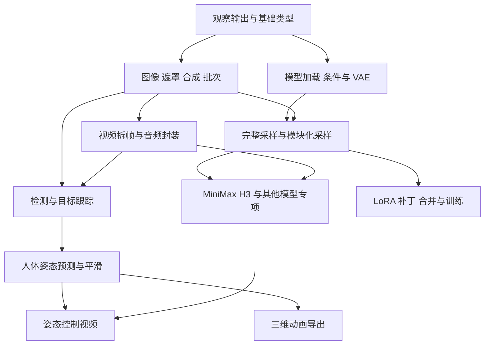

# 两种依赖都要看

[项目首页](../README.md) · [阅读指南](README.md)

**数据依赖**：下游所需对象必须由上游或外部输入提供。例如 MHR_POSE_DATA 必须先来自有效的姿态预测流程，BuildPoseFile 才能导出。

**学习依赖**：先学会观察 MASK，才能判断局部重绘到底改了哪里。学习前置不意味着这些节点必须出现在同一张画布。

端口兼容至少检查四层：

| 层次 | 要核对什么 | 例子 |
|---|---|---|
| 接口类型 | 消费者是否接受该类型或联合类型 | IMAGE、MASK、MHR_POSE_DATA |
| 数据结构 | 维度、批次、时间轴、额外字段 | 图像 batch 与视频 latent 时间维不同 |
| 模型语义 | 权重家族、文本编码器、VAE、任务变体 | H3 ref2va 与 fl2va 不因都是 MODEL 就互换 |
| 坐标与时间 | 尺寸、单位、FPS、帧网格和坐标系 | 3D 米/厘米，H3 的 17k+5 帧 |

不要按类型名称把所有可能生产者和消费者全部连起来。下面的箭头表示经过接口与任务语义核对的教学路线，不代表任意两端节点都能直接相连。

三维网格、splat、音频生成可以从对应外部素材和模板另开分支；不要求先学完所有图像模型。
